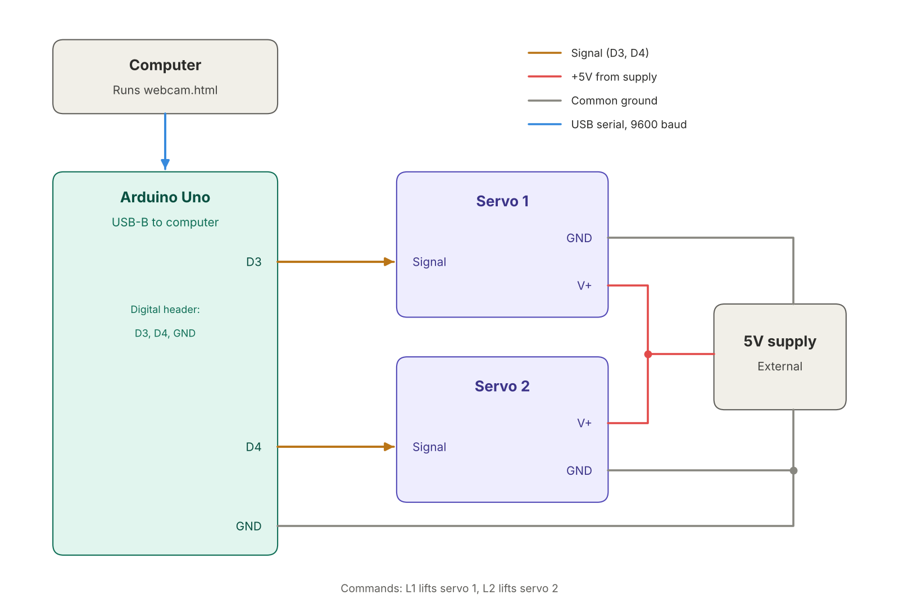

# Smart Waste Segregator

A browser-based waste classification tool. It uses an image model trained with [Teachable Machine](https://teachablemachine.withgoogle.com/) to look at an item through your webcam and tell you which category of waste it belongs to. An optional Arduino Uno version lifts a servo-driven lid to sort the item into the right bin.

No backend is needed: the classification runs in the browser using TensorFlow.js.

## How it works

1. You train an image classification model in Teachable Machine (one class per waste category) and export it as a TensorFlow.js model.
2. You open `webcam.html` and upload the three exported model files.
3. The page starts your webcam and shows live predictions for each class.
4. Click **Evaluate**. For 5 seconds the page averages the model's predictions, then shows a popup with the winning class and its average match percentage.

Averaging over a few seconds makes the final answer more stable than a single frame.

The included model (`Model/`) has two classes: **Recyclable Waste** and **Non-Recyclable Waste**.

## Repository structure

```
smart-waste-segregator/
├── Model/                      # Exported Teachable Machine model files
├── ARDUINO-VERSION/
│   ├── waste_sorter/
│   │   └── waste_sorter.ino    # Arduino sketch (two servo lifts)
│   ├── webcam_arduino.html     # Webcam page that also talks to the Arduino
│   └── arduino_uno_wiring.png  # Wiring diagram
├── upload.html                 # Classify from an uploaded picture
├── webcam.html                 # Live webcam classification page
└── LICENSE                     # Apache-2.0
```

## Getting started

### Requirements

- A modern browser (Chrome, Edge, Firefox, Safari)
- A webcam
- Internet access on first load (TensorFlow.js and the Teachable Machine library are loaded from the jsDelivr CDN)

### Run it

Browsers only allow camera access on `localhost` or HTTPS, so serve the folder locally instead of opening the file directly:

```bash
git clone https://github.com/mukundzoom2-dev/smart-waste-segregator.git
cd smart-waste-segregator
python3 -m http.server 8000
```

Then open `http://localhost:8000/webcam.html`.

### Use it

1. Click **Choose Files** and select all three model files at once (they are in the `Model/` folder):
   - `model.json`
   - `metadata.json`
   - `weights.bin`

   Keep the original file names. `model.json` references `weights.bin` by name, and the page will show an error if the names don't match.
2. Once all three show a green check, click **Start** and allow camera access.
3. Hold an item in front of the camera and watch the live class probabilities.
4. Click **Evaluate** and keep the item steady for 5 seconds.
5. Read the result in the popup. Click **Evaluate again** to test another item, or **Stop** to release the camera.

### Classify a single picture

`upload.html` lets you pick an image file and shows the prediction for each class.

## Training your own model

1. Go to [Teachable Machine](https://teachablemachine.withgoogle.com/) and create a new **Image Project** (Standard image model).
2. Create one class per waste category and add plenty of varied sample images of each.
3. Train the model, then choose **Export Model** → **TensorFlow.js** → **Download**.
4. Unzip the download. You will get `model.json`, `metadata.json` and `weights.bin`, which you upload in the page.

## Configuration

These values are at the top of the script in `webcam.html`:

| Setting | Default | Description |
| --- | --- | --- |
| `UPDATE_INTERVAL_MS` | `500` | How often the model runs on the webcam frame (ms) |
| `EVAL_DURATION_MS` | `5000` | How long the Evaluate step collects predictions (ms) |

## Hardware (Arduino version)

The Arduino version sorts the item physically. After each Evaluate, the page sends a command over USB serial and the Arduino lifts the matching lid.

- **Board:** Arduino Uno
- **Components:** 2 servo motors, breadboard, bins, external 5V supply for the servos



### Pin table

| Connection | Arduino Uno pin |
| --- | --- |
| Servo 1 signal | D3 |
| Servo 2 signal | D4 |
| Servo power (V+) | External 5V supply (not the Arduino's 5V pin) |
| Servo ground | Supply GND, joined to Arduino GND |

The servos must share a common ground with the Arduino, otherwise the signal pins won't work reliably.

### How it connects to the classifier

- The page talks to the Arduino over USB serial at 9600 baud using the browser's Web Serial API.
- Class 1 in the model sends `L1` (lift 1, servo on D3). Class 2 sends `L2` (lift 2, servo on D4).
- On a command, the sketch raises the servo from 0° to 90°, holds for 3 seconds, lowers it, and replies `Lift N done`.
- Only two classes are supported, one per lift.

### Set it up

1. Open `ARDUINO-VERSION/waste_sorter/waste_sorter.ino` in the Arduino IDE and upload it to the Uno.
2. Wire the servos as shown above.
3. Serve the repo (`python3 -m http.server 8000`) and open `http://localhost:8000/ARDUINO-VERSION/webcam_arduino.html` in **Chrome or Edge on a computer**. Web Serial isn't available in Firefox or Safari.
4. Click **Connect Arduino**, choose the Arduino's port, and wait about 2 seconds for the board to restart.
5. Use **Test lift 1** and **Test lift 2** to check the servos, then upload the model files, click **Start**, and **Evaluate**.

You can change `REST_ANGLE`, `LIFT_ANGLE`, `HOLD_MS` and `STEP_DELAY_MS` at the top of the sketch to adjust the lift.

## Tips for better accuracy

- Train with images taken in the same lighting and background you'll use at runtime.
- Include several angles and examples per class, and add a "nothing / background" class.
- Keep the item centred and fill most of the frame.

## Built with

- [TensorFlow.js](https://www.tensorflow.org/js) 1.3.1
- [@teachablemachine/image](https://github.com/googlecreativelab/teachablemachine-community) 0.8
- Plain HTML, CSS and JavaScript
- Arduino `Servo` library

## Contributing

Issues and pull requests are welcome. For larger changes, please open an issue first to discuss what you'd like to change.

## License

Distributed under the Apache License 2.0. See [`LICENSE`](LICENSE) for details.
